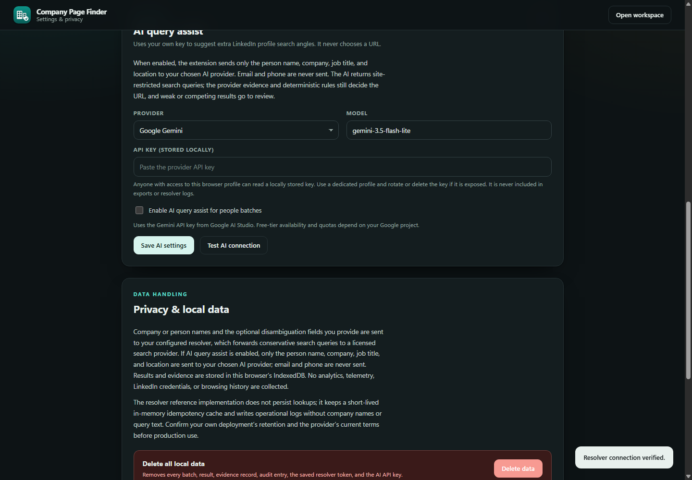

# Company Page Finder

Turn a list of **companies or people** into evidence-backed LinkedIn company page or profile URLs — in Chrome or Microsoft Edge — without scraping LinkedIn, logging in, or letting a language model guess a slug.

A URL is shown only when a licensed search provider returned that page and one deterministic rule set accepts it. Ambiguous names stay in a review queue. Nothing is invented.


## The accuracy contract

- **Never fabricate a URL.** The extension never builds `linkedin.com/company/<name>` or `linkedin.com/in/<name>` from an input. A canonical URL can only come from a provider result that already passed strict URL validation.
- **No AI in the matching path.** Normalization, URL parsing, query planning, corroboration, and the final decision are pure, testable TypeScript. The optional AI assist can only propose site-restricted search queries; it cannot return or select a URL.
- **Ambiguity is a feature, not a failure.** Two plausible pages, a weak title match, a short name without context, or a person name without company/title/location produces `REVIEW_REQUIRED` with a blank selected URL.
- **Failures never become matches.** Provider, network, auth, AI, and validation errors are visible states that can be retried; an AI failure falls back to the deterministic queries.
- **No LinkedIn access.** No LinkedIn host permission, cookies, content scripts, scraping, automation, CAPTCHA solving, or unofficial APIs.
- **Honest language.** “High-confidence match” means the stored evidence passed deterministic checks. It is not a claim that LinkedIn verified the page or profile.

> “Zero invented URLs” is enforceable and tested. “Every company or person name in the world resolves correctly” is not, especially for names that are ambiguous, stale, or shared. Add an official domain/country for companies, or a company/title/location for people, when precision matters.

## What it does

- **Company mode:** bulk paste or UTF-8 CSV import (`company_name` plus optional country, region, city, official domain/website, alias, notes).
- **People mode:** UTF-8 CSV import (`full_name` plus optional company, job title, location, email, phone, notes). Email and phone are local-only and are never sent to the search or AI provider.
- **Optional BYOK AI query assist:** Gemini, xAI Grok, or OpenRouter. It suggests extra `/in/` search angles; deterministic rules still choose or refuse a URL. Keys are stored locally and can be deleted.
- De-duplicates equivalent rows into one provider lookup while preserving **every original row** in results and exports.
- Durable, checkpointed batches: pause, resume, cancel, retry errors, retry selected rows, and continue after closing the workspace.
- Live counters, progress, sortable/filterable table, and a per-row evidence drawer.
- Human review: accept or reject only candidates the provider returned; the local audit trail records who and when.
- CSV and JSON exports that always include matched, confirmed, review, not-found, and error rows with evidence.
- Minimal MV3 permission surface: `storage`, `alarms`, `downloads`, and one build-time resolver host. AI providers are **optional** host permissions granted only when you enable that provider.
- Full settings page with resolver connection test, AI provider test, retention, local data deletion, and build information.




## Status model

| Status            | Meaning                                                                                       | Selected URL     |
| ----------------- | --------------------------------------------------------------------------------------------- | ---------------- |
| `MATCHED`         | Exactly one provider-returned page/profile matched the name, with the required corroboration. | Present          |
| `USER_CONFIRMED`  | A human explicitly accepted a provider-returned candidate.                                    | Present, audited |
| `REVIEW_REQUIRED` | Valid candidate pages/profiles exist, but the rules cannot safely pick one.                   | Blank            |
| `NOT_FOUND`       | The search completed and returned no valid LinkedIn `/company/` or `/in/` URL.                | Blank            |
| `ERROR`           | Provider/network/auth/validation failure after retry policy.                                  | Blank            |

Why these are separate, and where false positives/negatives remain possible, is documented in [docs/ACCURACY_POLICY.md](docs/ACCURACY_POLICY.md).

## How a lookup works

```text
Paste / CSV
   → validate + normalize + de-duplicate
   → resolver plans conservative queries such as
        site:linkedin.com/company/ "Exact Company Name"
        site:linkedin.com/in/ "Exact Person Name" "Company"
   → licensed provider returns verbatim titles/URLs/snippets
   → strict URL parser accepts only linkedin.com/company/<slug> or /in/<slug>
   → deterministic rules: exact normalized name, competing candidates,
     domain/country/second-query corroboration (companies) or
     company/title/location corroboration (people)
   → MATCHED / REVIEW_REQUIRED / NOT_FOUND / ERROR
   → local persistence, review, CSV/JSON export
```

For people, a name alone can never auto-match: at least one supplied company, job title, or location must appear in the evidence, and two exact-name profiles always go to review. If AI assist is enabled, it adds up to two validated, site-restricted queries per batch; an AI failure is recorded and the deterministic search continues.

The resolver service is a **search proxy**: it holds the provider credential, plans queries, enforces quotas, and returns structured evidence. The extension owns the decision, so the rules and audit trail remain transparent and testable.

## Repository layout

```text
apps/
  extension/        MV3 workspace, options page, service worker, job engine
  api/              HTTPS resolver: Brave adapter, auth, quotas, retries, idempotency
packages/
  matching/         pure URL/normalization/query/rules engine — no network, no DOM, no AI
  test-fixtures/    sanitized fake provider data for tests and the offline demo
docs/               architecture, accuracy, privacy, acceptable use, store, context
tools/              build, package, dist validation, icon + browser smoke scripts
.github/workflows/  CI
```

## Quick start (offline mock provider)

Requirements: Node.js **20.19+** (tested on Node 24), npm, and Chrome/Edge 116+.

```powershell
npm install
Copy-Item .env.example .env
```

Edit `.env`:

```dotenv
SEARCH_PROVIDER=mock
RESOLVER_ACCESS_TOKENS=local-dev-token-1234567890
```

Start the resolver:

```powershell
npm run api:start
```

In a second terminal, build the development extension:

```powershell
npm run build:dev
```

Then:

1. Open `chrome://extensions` (or `edge://extensions`).
2. Enable **Developer mode**.
3. Choose **Load unpacked** and select `dist/extension-dev`.
4. Click the toolbar icon (or the tab that opens on install).
5. Open **Settings**, paste `local-dev-token-1234567890`, and choose **Save & test**.
6. Return to the workspace and choose **Companies** or **People**, then **Load example list** → **Start batch**.

The mock provider knows the sanitized company demos (Microsoft, Example Private Ltd, Acme, Umbrella, Initech) and people demos (Ada Lovelace, Grace Hopper, Alan Turing, Noah Body). Unknown names return no results. It never invents a page and is rejected at startup when `NODE_ENV=production`.

## Production setup

### 1. Deploy the resolver

The resolver is a small Node service. Any host that can keep a secret and run a container works. Example (Render/Fly/Railway/VM):

```bash
npm ci
npm run build:api
node dist/api/server.js
```

Required environment:

| Variable                 | Purpose                                                                              |
| ------------------------ | ------------------------------------------------------------------------------------ |
| `SEARCH_PROVIDER=brave`  | Use the Brave Web Search adapter.                                                    |
| `BRAVE_API_KEY`          | Server-side only. Never put this in the extension or Git.                            |
| `RESOLVER_ACCESS_TOKENS` | Comma-separated bearer tokens, each ≥16 chars. Generate with `openssl rand -hex 32`. |
| `NODE_ENV=production`    | Rejects the mock provider.                                                           |

Useful controls: `PORT`, `HOST`, `ALLOWED_ORIGINS`, `CACHE_TTL_MS`, `RATE_LIMIT_PER_MINUTE`, `PROVIDER_CONCURRENCY`, `PROVIDER_TIMEOUT_MS`, `BATCH_TIMEOUT_MS`, `LOG_LEVEL`.

Put HTTPS in front of it (managed platform TLS or a reverse proxy). The service sends `Cache-Control: no-store`, security headers, strict body-size limits, and structured logs without names, query text, or tokens.

Review the current [Brave Web Search API documentation](https://api-dashboard.search.brave.com/app/documentation/web-search/get-started) and terms/pricing before production use. The adapter calls `GET https://api.search.brave.com/res/v1/web/search` with `X-Subscription-Token`, `count=10`, and `safesearch=strict`.

### 2. Build and install the extension

Set the resolver origin at build time. This becomes the single `host_permissions` entry:

```powershell
$env:RESOLVER_ORIGIN="https://resolver.your-domain.example"
npm run build
npm run validate:dist
```

Load `dist/extension` unpacked, then provision the same access token in **Settings**. For store packages:

```powershell
npm run package
```

This refuses to package while the placeholder origin is still present. `--allow-unconfigured` is for local QA artifacts only.

> The current local build uses `https://resolver.example.com` as a placeholder because no resolver deployment or GitHub credentials were provided. Rebuild with your real origin before publishing.

### Optional AI query assist (BYOK)

1. Open **Settings → AI query assist**.
2. Choose Gemini, xAI Grok, or OpenRouter; set the model ID and paste the provider key.
3. Tick **Enable AI query assist**, then **Save AI settings** and accept the optional host-permission prompt.
4. Choose **Test AI connection**. In People mode, batches can now receive up to two extra validated `site:linkedin.com/in/` queries.

The key stays in `chrome.storage.local`, is sent only to the selected AI provider, and is removed by **Delete all local data**. The AI never receives email/phone and never returns a URL; deterministic evidence rules still select or refuse the profile.

## CSV format

**Companies**

```csv
company_name,country,region,city,official_domain,official_website,alias,notes
Microsoft,United States,Washington,Redmond,microsoft.com,https://www.microsoft.com,,
Example Private Ltd,India,Maharashtra,Pune,example.in,https://example.in,Example Pvt Ltd,
```

**People**

```csv
full_name,company,job_title,location,email,phone,notes
Ada Lovelace,Analytical Engines,Mathematician,"London, England",ada@example.test,,
Grace Hopper,United States Navy,Rear Admiral,"Arlington, Virginia",,,
```

Only `company_name` or `full_name` is required. Optional facts can **narrow** the query and add corroboration; they can never create a URL. Email and phone are local-only and are never sent to the provider or an AI assistant. UTF-8, RFC-4180 quoting, BOM, CRLF/LF, and tolerant header aliases are supported. A 5,000-row batch limit is enforced.

## Quality gates

```bash
npm run typecheck      # strict TS for matching, API, extension
npm run lint           # ESLint, zero warnings
npm run format:check   # Prettier
npm test               # unit + integration tests (Vitest)
npm run coverage       # v8 coverage summary
npm run build          # production extension (uses a placeholder origin if RESOLVER_ORIGIN is unset)
npm run build:api      # bundled resolver
npm run validate:dist  # manifest/permissions/CSP/secret/package checks
npm run check          # everything above in order
```

The browser smoke test (real Chrome for Testing, real extension, local mock resolver) is documented in [docs/context/VERIFICATION.md](docs/context/VERIFICATION.md) and run with `node tools/e2e-smoke.mjs` while Chrome is running with the unpacked build and `--remote-debugging-port=9223`.

## Permissions and privacy

| Permission                 | Why                                                                   |
| -------------------------- | --------------------------------------------------------------------- |
| `storage`                  | Save settings, the resolver token, and the optional AI key locally.   |
| `alarms`                   | Resume a checkpointed batch after the MV3 worker sleeps.              |
| `downloads`                | Save CSV/JSON exports.                                                |
| one resolver host          | Send lookup requests to the configured HTTPS endpoint.                |
| optional AI provider hosts | Requested only when you enable Gemini, xAI, or OpenRouter assistance. |

No `tabs`, `activeTab`, `scripting`, `webRequest`, history, clipboard, management, `<all_urls>`, or LinkedIn host permission. No remote code; all JavaScript is bundled at build time. AI keys are stored in `chrome.storage.local` — anyone with access to the browser profile can read them, so use a dedicated profile and rotate exposed keys. Read [docs/PRIVACY.md](docs/PRIVACY.md) and [docs/ACCEPTABLE_USE.md](docs/ACCEPTABLE_USE.md).

## Troubleshooting

| Symptom                                     | Likely cause / fix                                                                                                |
| ------------------------------------------- | ----------------------------------------------------------------------------------------------------------------- |
| Start button disabled                       | No valid rows, import errors, an active batch, or no saved token.                                                 |
| `401` / “Access token rejected”             | Token differs from `RESOLVER_ACCESS_TOKENS`; update it in Settings, then Resume.                                  |
| “Failed to fetch” / resolver unreachable    | API not running, wrong origin baked into the build, or host permission mismatch. Rebuild with `RESOLVER_ORIGIN`.  |
| Every row `ERROR` with provider unavailable | Provider key/quota/terms problem on the server. Check resolver logs (they never contain names or queries).        |
| Job paused at cooldown                      | Provider rate limit. It auto-resumes after the reported delay, or choose **Resume now**.                          |
| Owner needs HTTPS locally                   | Use a tunnel or install a local HTTPS proxy; production requires HTTPS.                                           |
| Export does nothing                         | `downloads` permission was removed, or the browser blocked the save dialog.                                       |
| AI assist “Permission needed”               | Save the AI section and accept the optional provider host permission prompt; reload Settings if it was dismissed. |
| AI test fails with 401/429                  | The AI key, plan, model ID, or quota is wrong; reset the key/model in Settings. Deterministic search still works. |

## Known limitations

- A company or person name alone can be ambiguous. Companies may be sent to review; people without a company, job title, or location always go to review rather than guess.
- Two profiles with the same exact name always go to review, even when one has more corroborating text.
- Provider index freshness, coverage, and terms are outside this project’s control.
- Exact normalized title matching can reject a valid page whose title uses a different brand/legal name; add an alias (companies) or confirm manually (people).
- AI query assist depends on the provider key, plan, quota, model ID, and current API shape. Model names change; fields are editable. AI failure falls back to deterministic queries and is shown as a batch note.
- AI keys saved in the extension are readable by anyone with access to that browser profile. This is a deliberate BYOK trade-off; use a dedicated profile and rotate keys.
- The resolver reference implementation uses an in-memory idempotency/rate-limit store and expects a single instance (or an external shared limiter for horizontal scale).
- Store submission is **not** performed by the build. See [docs/STORE_SUBMISSION.md](docs/STORE_SUBMISSION.md).

## Security and contributing

See [SECURITY.md](SECURITY.md) and [CONTRIBUTING.md](CONTRIBUTING.md). Accuracy invariants are not negotiable: a change that constructs a URL from a name, adds an LLM to the decision path, or turns a provider failure into a match will be rejected.

## License and disclaimer

MIT. See [LICENSE](LICENSE).

Company Page Finder is an independent project. It is not affiliated with, endorsed by, or certified by LinkedIn, Microsoft, Google, xAI, OpenRouter, or Brave. LinkedIn is a trademark of its owner. The tool finds public URL candidates from licensed search-provider evidence; it does not scrape LinkedIn.
