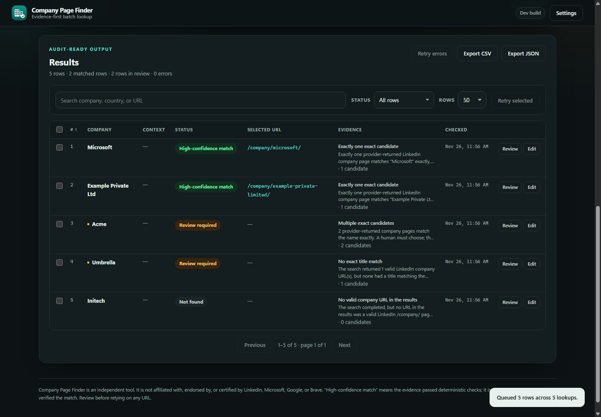
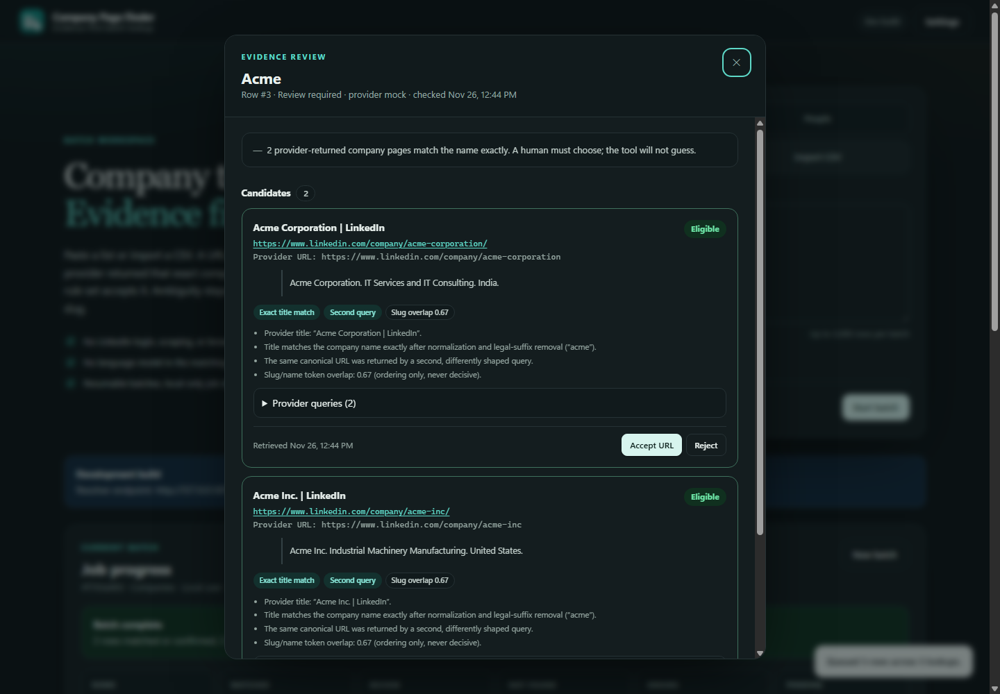
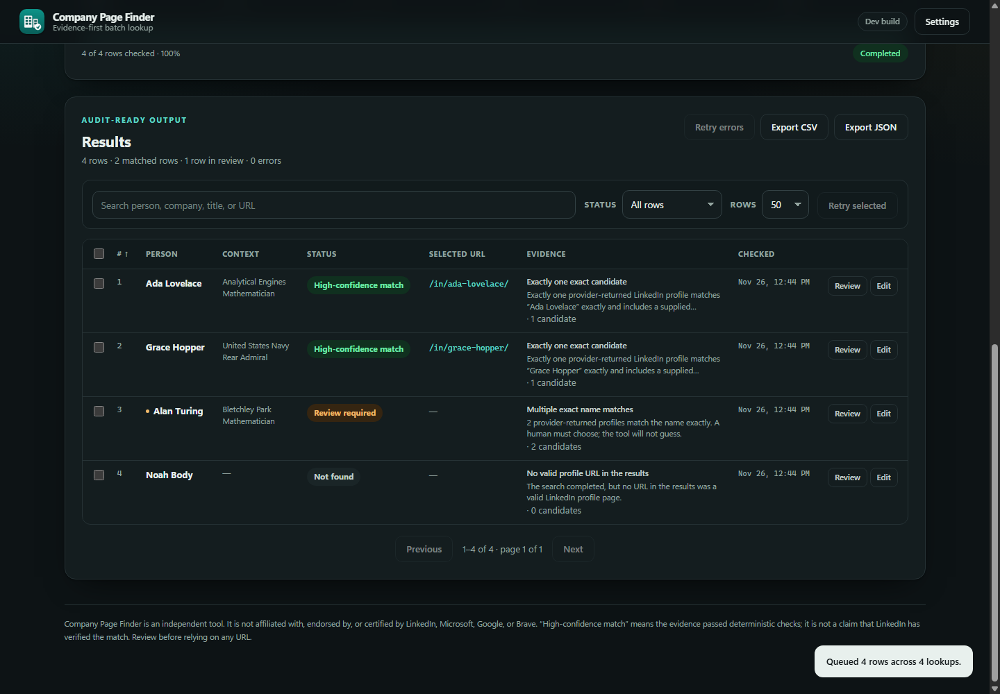
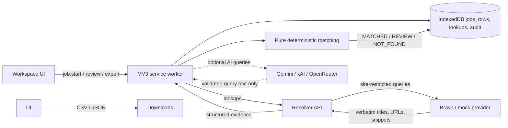

# Company Page Finder

**Bulk company names or people → evidence-backed LinkedIn company page or profile URLs — in Chrome and Microsoft Edge.**

Company Page Finder is a Manifest V3 extension with a small self-hosted resolver. It finds public LinkedIn URLs from a licensed search provider, validates every URL strictly, and **refuses to guess** when the evidence is weak. Ambiguity goes to a human review queue. An optional bring-your-own-key AI assistant can suggest extra search angles — it never invents, ranks, or selects a URL.

<p align="center">
  
</p>

> **Accuracy first:** a “high-confidence match” means the provider evidence passed deterministic rules. It is not a claim that LinkedIn certified the page, and it is not an AI guess.

---

## Table of contents

- [Why this exists](#why-this-exists)
- [Two lookup modes](#two-lookup-modes)
- [Feature tour](#feature-tour)
- [Screenshots](#screenshots)
- [Quick start: offline mock](#quick-start-offline-mock)
- [Production setup](#production-setup)
- [Using the workspace](#using-the-workspace)
- [CSV reference](#csv-reference)
- [Status model](#status-model)
- [Accuracy rules](#accuracy-rules)
- [AI query assist (BYOK)](#ai-query-assist-byok)
- [Architecture](#architecture)
- [Resolver API](#resolver-api)
- [Permissions](#permissions)
- [Privacy and security](#privacy-and-security)
- [Deployment](#deployment)
- [Local development](#local-development)
- [Testing and verification](#testing-and-verification)
- [Troubleshooting](#troubleshooting)
- [Known limitations](#known-limitations)
- [Project status](#project-status)
- [Repository layout](#repository-layout)
- [Contributing, security, license](#contributing-security-license)

---

## Why this exists

Most “company → LinkedIn URL” tools either scrape LinkedIn, guess a slug from the company name, or ask an LLM to produce a plausible-looking URL. Those approaches fail silently: a wrong URL looks exactly like a right one.

This project takes the opposite position:

- A URL is displayed **only** when a licensed search provider returned that page and the URL passed strict validation.
- The matching decision is deterministic, explainable TypeScript: no model score, no hallucinated slug.
- Competing or weak evidence stays in **Review required** with no selected URL.
- Provider failures remain visible errors; they are never converted into matches.
- The extension never requests a LinkedIn host permission, never logs in to LinkedIn, never scrapes it, and never automates it.
- Optional AI is limited to **query text**. It cannot return or choose a URL.

“Zero invented URLs” is enforceable and tested. “Every company or person name in the world resolves correctly” is not. That is why the product is precision-first and why the review queue exists.

---

## Two lookup modes

|                     | Companies                                                                                                           | People                                                                                                                                |
| ------------------- | ------------------------------------------------------------------------------------------------------------------- | ------------------------------------------------------------------------------------------------------------------------------------- |
| Input               | `company_name` + optional country/region/city/domain/website/alias/notes                                            | `full_name` + optional company, job title, location, email, phone, notes                                                              |
| URL family          | `linkedin.com/company/<slug>`                                                                                       | `linkedin.com/in/<slug>`                                                                                                              |
| Auto-match evidence | Exact normalized company/alias name; one unique candidate; domain/country/second-query corroboration for weak names | Exact normalized person name; one unique candidate; at least one supplied company, job title, or location must appear in the evidence |
| Name-only           | May match if the name is strong and unique                                                                          | Always Review required — people names are not unique                                                                                  |
| Email / phone       | n/a                                                                                                                 | Local export metadata only; never sent to the search or AI provider                                                                   |
| AI assist           | Not used                                                                                                            | Optional query expansion                                                                                                              |

Both modes share the same durable job engine, review drawer, audit trail, retention, exports, and safety rules.

---

## Feature tour

### Input and validation

- Paste one company or person name per line.
- Import UTF-8 CSV with quoted fields, escaped quotes, embedded newlines, BOM, CRLF/LF.
- Company CSV: `company_name,country,region,city,official_domain,official_website,alias,notes`.
- People CSV: `full_name,company,job_title,location,email,phone,notes`.
- Tolerant header aliases (`company`, `name`, `domain`, `website`, `title`, `employer`, …).
- Validation errors are shown with line numbers **before** a batch starts.
- Empty names, control characters, over-long values, invalid domains/websites/emails are rejected.
- Up to 5,000 rows per batch. A 5,000-row guard is enforced in the engine and UI.

### De-duplication without losing rows

Equivalent inputs — case, punctuation, legal suffixes, whitespace, and supplied context — are collapsed into one provider lookup. Every original CSV/paste row still appears in results and exports with its original row number.

### Durable, resumable batches

- Batches run in the MV3 service worker and checkpoint after every small batch.
- Close the workspace, reload the extension, or let the service worker sleep: job state survives in IndexedDB.
- Pause, resume, cancel, retry failed rows, retry selected rows, or resume after a provider cooldown.
- A crashed/interrupted batch is recovered by resetting `IN_PROGRESS` lookups to `PENDING`; rows are written before lookups so a row can never be stranded.
- Idempotency keys are derived from the job and sorted lookup keys, so a retried batch does not duplicate a successful provider call.
- Provider rate limits pause the job and auto-resume after the reported cooldown. Network/auth failures require an operator action.

### Deterministic evidence

- Strict URL parser: exact host allowlist and exact `/company/<slug>` or `/in/<slug>` path.
- Rejects people/jobs/schools/groups/showcase pages in company mode, and company pages in people mode, plus extra path segments, encoded separators, lookalike domains, credentials, ports, redirectors, and shorteners.
- Canonicalizes only a URL the provider returned; never constructs one from a name.
- Exact normalized name matching; legal suffixes removed for companies, credentials/`Last, First` handled for people.
- Corroboration signals from the provider title/snippet and a differently shaped query.
- A selected URL must be a candidate that the rule engine marked `selectable`; an invariant assertion rejects anything else.

### Human review

Every row has a review drawer with:

- every provider-returned candidate, canonical and original URL;
- provider title and snippets;
- the exact search queries and their shapes;
- match/weakness signals and disqualifiers;
- the deterministic verdict (`Eligible`, `Needs review`, `Excluded`);
- rejected non-company/non-profile results (for example `/in/` in company mode);
- a local audit trail.

You can **accept** or **reject** only candidates the provider returned. Accepting an excluded candidate is an explicit “accept anyway” override, recorded as `USER_CONFIRMED`, never as an automatic match.

### Results table

- Sortable by row, name, status, confidence, and check time.
- Filter by status: all, matched/confirmed, review, not found, errors, pending.
- Full-text search across name, company, title, location, domain, URL, error, and evidence.
- Pagination, row selection, and bulk retry.
- Responsive card layout below 1020 px; a wide table on desktop.
- Status badges and evidence summaries; full details in the review drawer.

### Exports

- **CSV** with the original row, kind, company/person fields, status, selected URL, confidence, evidence, reason codes, provider, candidate count/URLs, error, confirmation, and timestamps.
- **JSON** with the complete raw input, full evaluation, candidates, excluded results, queries, job metadata, and audit entries.
- Exports always include unsuccessful, review, not-found, and error rows — never just successful rows.
- CSV cells neutralize spreadsheet formula injection (`=`, `+`, `-`, `@`, tab).
- UTF-8 BOM for Excel compatibility; CRLF line endings.

### Settings and privacy

- Resolver endpoint, save/test connection, masked token.
- Batch size, audit operator name, and retention (7/30/90/365 days or until cleared).
- Optional AI provider, model, key, enable toggle, and connection test.
- Delete all local data: jobs, evidence, audit, resolver token, and AI key.
- Build version, commit, time, endpoint, and permission summary.

### Optional AI query assist

- Providers: **Google Gemini**, **xAI Grok**, **OpenRouter**.
- Paste your own key in Settings; it is stored in this browser profile for future batches.
- AI proposes up to two extra `site:linkedin.com/in/` queries per person in a batch.
- Queries must contain the exact person name, start with the profile-site restriction, contain no URL, and not smuggle a slug into the site restriction. Validated twice: extension and resolver.
- AI never receives email/phone, never returns a URL, and never makes the decision.
- AI failure records a visible batch note and falls back to deterministic queries.
- Optional host permissions are requested only when you enable a provider.

---

## Screenshots

**Company results and evidence**


**Review drawer with provider evidence and audit**



**People results**



**AI query assist settings**


All screenshots use the sanitized mock fixtures; no customer data is shown.

---

## Quick start: offline mock

Requirements: Node.js **20.19+** (tested on Node 24), npm, Chrome/Edge 116+.

```powershell
npm install
Copy-Item .env.example .env
```

Edit `.env`:

```dotenv
SEARCH_PROVIDER=mock
RESOLVER_ACCESS_TOKENS=local-dev-token-1234567890
```

Terminal 1:

```powershell
npm run api:start
```

Terminal 2:

```powershell
npm run build:dev
```

1. Open `chrome://extensions` (or `edge://extensions`).
2. Enable **Developer mode**.
3. **Load unpacked** → `dist/extension-dev`.
4. Open the workspace from the toolbar icon.
5. Settings → paste `local-dev-token-1234567890` → **Save & test**.
6. Choose **Companies** or **People** → **Load example list** → **Start batch**.
7. Open **Review** on a review row, inspect candidates, accept or reject.
8. Export CSV or JSON.

The mock provider knows the sanitized company demos (Microsoft, Example Private Ltd, Acme, Umbrella, Initech) and people demos (Ada Lovelace, Grace Hopper, Alan Turing, Noah Body). Unknown names return no results. The mock provider cannot be enabled with `NODE_ENV=production`.

### What you should see

- Microsoft → high-confidence `/company/microsoft/`.
- Example Private Ltd → high-confidence `/company/example-private-limited/`.
- Acme → review (two exact candidates).
- Initech → not found (only profile/job URLs were returned).
- Ada Lovelace / Grace Hopper → high-confidence `/in/…`.
- Alan Turing → review (two exact-name profiles).
- Noah Body → not found.

---

## Production setup

### 1. Deploy the resolver

The resolver is a small Node service. Any host that can keep a secret and run a container works (Render, Fly, Railway, a VM, or your own container platform).

```bash
npm ci
npm run build:api
node dist/api/server.js
```

Required environment:

| Variable                 | Purpose                                                                                           |
| ------------------------ | ------------------------------------------------------------------------------------------------- |
| `SEARCH_PROVIDER=brave`  | Use the Brave Web Search adapter.                                                                 |
| `BRAVE_API_KEY`          | Server-side only. Never bundle it in the extension, commit it, or send it to a browser.           |
| `RESOLVER_ACCESS_TOKENS` | Comma-separated bearer tokens, each at least 16 characters. Generate with `openssl rand -hex 32`. |
| `NODE_ENV=production`    | Refuses the mock provider.                                                                        |

Useful controls:

| Variable                | Default     | Purpose                                   |
| ----------------------- | ----------- | ----------------------------------------- |
| `PORT`                  | `8787`      | HTTP port.                                |
| `HOST`                  | `127.0.0.1` | Bind address.                             |
| `ALLOWED_ORIGINS`       | empty       | Optional CORS allowlist for a web origin. |
| `CACHE_TTL_MS`          | `900000`    | In-memory idempotency cache TTL.          |
| `RATE_LIMIT_PER_MINUTE` | `30`        | Per-token request limit.                  |
| `PROVIDER_CONCURRENCY`  | `2`         | Max concurrent provider calls.            |
| `PROVIDER_TIMEOUT_MS`   | `8000`      | Per-provider-request timeout.             |
| `BATCH_TIMEOUT_MS`      | `50000`     | Resolver batch budget.                    |
| `LOG_LEVEL`             | `info`      | `debug`, `info`, `warn`, or `error`.      |

Put HTTPS in front of it with a managed certificate or reverse proxy. The service sends `Cache-Control: no-store`, `X-Content-Type-Options: nosniff`, `Referrer-Policy: no-referrer`, strict body limits, and structured logs without names, query text, URLs, or tokens.

Review the current [Brave Web Search API documentation](https://api-dashboard.search.brave.com/app/documentation/web-search/get-started) and terms/pricing before launch. The adapter calls `GET https://api.search.brave.com/res/v1/web/search` with `X-Subscription-Token`, `count=10`, and `safesearch=strict`.

### 2. Build the extension with your resolver origin

The resolver origin is baked into the manifest at build time, keeping `host_permissions` to exactly one narrow origin.

```powershell
$env:RESOLVER_ORIGIN="https://resolver.your-domain.example"
npm run build
npm run validate:dist
```

Load `dist/extension` unpacked, provision the same access token in Settings, and run a small batch.

### 3. Package for a browser store (owner action)

```powershell
npm run package
```

`npm run package` refuses to produce a package while the placeholder `resolver.example.com` origin is present. `--allow-unconfigured` is only for local QA artifacts.

> The local build in this repository currently uses `https://resolver.example.com` as a placeholder because no resolver deployment is committed with the code. Rebuild with your own origin before any public distribution.

### 4. Optional AI keys

Open Settings → AI query assist:

1. Choose Gemini, xAI Grok, or OpenRouter.
2. Set the model ID (defaults: `gemini-3.5-flash-lite`, `grok-4.5`, `openrouter/auto`).
3. Paste the provider key and enable AI assist.
4. Save and accept the optional host-permission prompt.
5. **Test AI connection**.

The key is stored in `chrome.storage.local`, sent only to that provider, and removed by **Delete all local data**. Model IDs are editable because providers change their catalogues and quotas.

---

## Using the workspace

### Step 1 — choose a mode

**Companies** or **People**. Mode changes the input labels, CSV expectations, and results column. A batch cannot mix companies and people.

### Step 2 — add input

**Paste** one name per line for a quick list. For people, a name alone is intentionally review-only; use the CSV to add company/title/location context.

**Import CSV** for the full schema. Drag a file onto the drop zone or click to choose one. CSV quoting, escaped quotes, embedded newlines, BOM, and CRLF/LF are supported.

The import summary shows valid rows, duplicate rows that will share a lookup, and issues. Start is disabled while any import error exists.

### Step 3 — start and monitor

The job panel shows total, matched, review, not found, errors, and pending counts, plus a progress bar and the current batch state.

- **Pause** stops new provider calls at the next batch boundary.
- **Resume** continues the checkpointed queue.
- **Cancel** stops the job but preserves collected evidence.
- **Retry errors** re-queues rows with `ERROR`.
- **Retry selected** re-queues checked rows (all rows sharing a lookup are reset consistently).
- A rate-limit cooldown resumes automatically after the reported window.

### Step 4 — review

Use **Review** on any row:

- Read the reason summary.
- Inspect each candidate’s canonical URL, original provider URL, title, snippets, signals, and queries.
- Accept one candidate → `USER_CONFIRMED`, with actor/time in the local audit trail.
- Reject a candidate → recorded; if it was the selected URL, the row returns to `REVIEW_REQUIRED`.

Review is the correct place to resolve Acme-style same-name collisions, brand/legal-name differences, and unusual titles. The tool never picks the “closest” result for you.

### Step 5 — refine a row

**Edit** adds or changes optional context:

- Companies: country, region, city, official domain/website, alias, notes.
- People: company, job title, location, email, phone, notes.

The original name is preserved in exports. Saving re-queues the lookup; context narrows queries and can add corroboration, but it never creates a URL.

### Step 6 — export

**Export CSV** and **Export JSON** include every original row:

- matched, user-confirmed, review, not found, and error statuses;
- selected URL, confidence, evidence summary, reason codes, provider, check time;
- all candidate URLs, errors, confirmation actor/time;
- people fields (including local email/phone) in CSV/JSON.

`downloads` permission is used only to save these files.

### Step 7 — clean up

Settings → **Delete all local data** removes jobs, rows, evidence, audit entries, the resolver token, and the AI key. Retention can also be set to 7/30/90/365 days or “until I clear them”.

---

## CSV reference

### Companies

```csv
company_name,country,region,city,official_domain,official_website,alias,notes
Microsoft,United States,Washington,Redmond,microsoft.com,https://www.microsoft.com,,
Example Private Ltd,India,Maharashtra,Pune,example.in,https://example.in,Example Pvt Ltd,
Acme,,,,,,,
```

| Column                      | Required | Notes                                                    |
| --------------------------- | -------- | -------------------------------------------------------- |
| `company_name`              | Yes      | 1–200 characters; control characters rejected.           |
| `country`, `region`, `city` | No       | Up to 120 characters; used as disambiguation evidence.   |
| `official_domain`           | No       | Bare host or URL; normalized to a host.                  |
| `official_website`          | No       | HTTP(S) URL or bare host.                                |
| `alias`                     | No       | Trading/former name; can match a provider title exactly. |
| `notes`                     | No       | Up to 500 characters; **not** sent as a search query.    |

### People

```csv
full_name,company,job_title,location,email,phone,notes
Ada Lovelace,Analytical Engines,Mathematician,"London, England",ada@example.test,,
Grace Hopper,United States Navy,Rear Admiral,"Arlington, Virginia",,,
Alan Turing,Bletchley Park,Mathematician,"Bletchley, England",,,
```

| Column                             | Required | Notes                                                                          |
| ---------------------------------- | -------- | ------------------------------------------------------------------------------ |
| `full_name`                        | Yes      | 1–200 characters; exact normalized name matching.                              |
| `company`, `job_title`, `location` | No       | Up to 200 characters; at least one must appear in the evidence for auto-match. |
| `email`, `phone`                   | No       | Local export metadata only; never sent to resolver, search provider, or AI.    |
| `notes`                            | No       | Up to 500 characters; local only.                                              |

UTF-8, RFC-4180 quoting, escaped quotes, embedded newlines, BOM, CRLF/LF, and tolerant header aliases are supported. **5,000 rows maximum** per batch.

---

## Status model

| Status            | Meaning                                                              | Selected URL             |
| ----------------- | -------------------------------------------------------------------- | ------------------------ |
| `PENDING`         | Waiting to be searched.                                              | Blank                    |
| `IN_PROGRESS`     | A provider batch is running.                                         | Blank                    |
| `MATCHED`         | Exactly one provider-returned candidate passed every automatic rule. | Present, evidence-backed |
| `USER_CONFIRMED`  | A human explicitly accepted a provider-returned candidate.           | Present, audited         |
| `REVIEW_REQUIRED` | Valid candidates exist, but the rules cannot safely choose.          | Blank                    |
| `NOT_FOUND`       | A completed search returned no valid `/company/` or `/in/` URL.      | Blank                    |
| `ERROR`           | Provider/network/auth/validation failure after retry policy.         | Blank                    |

`MATCHED` is described in the UI as **High-confidence match** — evidence-backed, not LinkedIn-verified.

---

## Accuracy rules

The full normative policy is in [docs/ACCURACY_POLICY.md](docs/ACCURACY_POLICY.md). The essentials:

### URL rules

- Only `http:`/`https:`.
- Host exactly `linkedin.com` or ending in `.linkedin.com`.
- Company mode: path exactly `/company/<slug>` with an optional trailing slash.
- People mode: path exactly `/in/<slug>` with an optional trailing slash.
- Reject profiles in company mode and companies in people mode; extra path segments; empty/dotted/encoded slugs; credentials; ports; lookalike hosts; redirectors/shorteners.
- Strip query/fragment only after validation; canonicalize an already-discovered URL only.

### Company auto-match

1. Exactly one valid candidate.
2. Exact normalized company or alias match in the provider title.
3. No second exact candidate.
4. If the name is short/generic/ambiguous, at least one of: supplied domain mentioned, supplied country/city mentioned, or same candidate from a second differently shaped query.

Fuzzy/slug overlap can order a review list but can never auto-select.

### People auto-match

1. Exactly one valid profile candidate.
2. Exact normalized full-name match in the provider title.
3. No second exact-name candidate.
4. Name has at least two tokens.
5. At least one supplied company, job title, or location appears in the provider title/snippet.

A name-only person lookup always goes to review. Two people with the same exact name always go to review.

### Failures

Provider errors, timeouts, auth failures, schema failures, and AI failures are visible and retryable. They never become `MATCHED`.

---

## AI query assist (BYOK)

AI is optional. It is **not** in the matching decision.

| Provider      | Default model           | Key source       | Notes                                                                    |
| ------------- | ----------------------- | ---------------- | ------------------------------------------------------------------------ |
| Google Gemini | `gemini-3.5-flash-lite` | Google AI Studio | Free-tier availability/quotas depend on your project. Model ID editable. |
| xAI Grok      | `grok-4.5`              | xAI              | Model ID editable; check current plan/pricing.                           |
| OpenRouter    | `openrouter/auto`       | OpenRouter       | One key for many models, including free slugs. Model ID editable.        |

How it works:

1. In a People batch, the service worker sends up to 10 person lookups (name, company, job title, location) to the selected AI provider.
2. The provider returns JSON with up to two proposed `site:linkedin.com/in/` queries per person.
3. The extension validates each query: starts with the site restriction, contains the exact name, no URL, no profile slug after `/in/`, length bounds, duplicates removed.
4. Valid queries are attached to the resolver request; the resolver validates them again and adds them as `ai` query shapes.
5. Matching still requires the exact name and a supplied context signal. AI can improve recall; it cannot select a wrong-name URL or manufacture a match.

If the AI call fails, the job shows an “AI assist unavailable” note and continues with deterministic queries. Email and phone are never sent to AI. Keys are stored in `chrome.storage.local`, visible to anyone with access to that browser profile; use a dedicated profile and rotate exposed keys.

---

## Architecture



- **Extension:** full-page workspace, options, service worker, durable job engine, IndexedDB, review/audit, exports.
- **Resolver:** holds the licensed search key, plans queries, auth, quotas, retries, idempotency, returns verbatim evidence; it does **not** decide matches.
- **Matching package:** pure URL/normalization/query/rules engine; no network, DOM, clock, randomness, or AI.

Read [docs/ARCHITECTURE.md](docs/ARCHITECTURE.md) for the lifecycle, schemas, threat model, and durability design.

---

## Resolver API

The extension calls the resolver over HTTPS with a per-user bearer token.

`POST /v1/search`

```json
{
  "schemaVersion": 1,
  "idempotencyKey": "a-64-char-hex-digest",
  "lookups": [
    {
      "id": "l0",
      "kind": "company",
      "companyName": "Example Private Ltd",
      "country": "India",
      "officialDomain": "example.in"
    },
    {
      "id": "l1",
      "kind": "person",
      "fullName": "Ada Lovelace",
      "company": "Analytical Engines",
      "jobTitle": "Mathematician",
      "location": "London"
    }
  ]
}
```

The response contains planned queries and verbatim provider results:

```json
{
  "schemaVersion": 1,
  "provider": "brave",
  "generatedAt": "2026-11-26T10:00:00.000Z",
  "results": [
    {
      "id": "l1",
      "queries": [
        {
          "query": "site:linkedin.com/in/ \"Ada Lovelace\"",
          "shape": "primary",
          "rationale": "Exact person name restricted to LinkedIn profile pages."
        }
      ],
      "results": [
        {
          "originalUrl": "https://www.linkedin.com/in/ada-lovelace/",
          "title": "Ada Lovelace - Mathematician - Analytical Engines | LinkedIn",
          "snippet": "London, England · Analytical Engines",
          "provider": "brave",
          "query": "site:linkedin.com/in/ \"Ada Lovelace\"",
          "shape": "primary",
          "retrievedAt": "2026-11-26T10:00:00.000Z"
        }
      ],
      "errors": [],
      "cached": false
    }
  ]
}
```

Other endpoints:

| Method | Path         | Auth | Purpose                                 |
| ------ | ------------ | ---- | --------------------------------------- |
| `GET`  | `/healthz`   | No   | Liveness, version, provider name.       |
| `GET`  | `/v1/whoami` | Yes  | Settings connection test.               |
| `POST` | `/v1/search` | Yes  | Small lookup batch → verbatim evidence. |

Limits: 25 lookups/request, 64 KiB body, 90 s HTTP ceiling, 50 s batch budget, per-token rate limit, provider concurrency 2, 3 retry attempts with jitter for retryable errors. Idempotency keys are bound to a payload fingerprint; reuse with a different payload returns `409`.

---

## Permissions

| Permission        | Why                                                                                  |
| ----------------- | ------------------------------------------------------------------------------------ |
| `storage`         | Save the resolver token, optional AI key, operator/batch/retention settings locally. |
| `alarms`          | Resume checkpointed batches after the MV3 worker sleeps or a provider cooldown ends. |
| `downloads`       | Save CSV/JSON exports.                                                               |
| One resolver host | Send lookups to the operator’s HTTPS resolver, fixed at build time.                  |
| Optional AI hosts | Requested only when enabling Gemini, xAI, or OpenRouter assist.                      |

No `tabs`, `activeTab`, `scripting`, `webRequest`, `history`, `cookies`, `management`, `clipboardRead`, `<all_urls>`, or LinkedIn host permission. No remotely hosted code; the extension bundles all executable JavaScript and restricts extension-page scripts to `self`.

---

## Privacy and security

- Company/person names and supplied context are sent to your resolver, which forwards conservative queries to the search provider.
- If AI assist is enabled, only person name, company, job title, and location are sent to the selected AI provider. Email/phone never leave the browser.
- Results, evidence, audit, email/phone, and settings are stored locally in IndexedDB/`chrome.storage.local`.
- The resolver keeps no lookup database; only a bounded in-memory idempotency cache and rate counters.
- Resolver logs contain request IDs, status, counts, and latency — not names, queries, URLs, or tokens.
- **Delete all local data** removes jobs, evidence, audit, resolver token, and AI key.
- The resolver access token and optional AI key are readable by anyone with access to the browser profile. Use a dedicated profile on shared machines and rotate exposed keys.
- The search-provider key exists only in the resolver environment/secret store and is never bundled in the extension.

Read [docs/PRIVACY.md](docs/PRIVACY.md) and [SECURITY.md](SECURITY.md).

---

## Deployment

### Docker

```bash
docker build -t company-page-finder-resolver .
docker run --rm -p 8787:8787 \
  -e SEARCH_PROVIDER=brave \
  -e BRAVE_API_KEY=... \
  -e RESOLVER_ACCESS_TOKENS=... \
  -e NODE_ENV=production \
  company-page-finder-resolver
```

Put TLS in front of the container. The image runs as the unprivileged `node` user and bundles only the resolver.

### Single-instance note

The in-memory idempotency cache and rate limiter are intentionally simple. For multiple resolver instances, put a shared limiter/cache in front of them or implement a shared store; document the chosen retention and auth model.

---

## Local development

```bash
npm ci
npm run api:start       # mock resolver
npm run build:dev       # extension
npm test                # unit/integration
npm run coverage
npm run typecheck
npm run lint
npm run check           # typecheck + lint + format + tests + builds + dist validation
```

Browser smoke test: start Chrome for Testing with `--load-extension=%CD%\dist\extension-dev --remote-debugging-port=9223`, then `node tools/e2e-smoke.mjs`. It covers company and people flows, review acceptance/audit, responsive layout, and AI settings surface. See [docs/context/VERIFICATION.md](docs/context/VERIFICATION.md).

Useful scripts:

| Script                  | Purpose                                                                      |
| ----------------------- | ---------------------------------------------------------------------------- |
| `npm run build`         | Production extension; uses `RESOLVER_ORIGIN` (placeholder warning if unset). |
| `npm run build:dev`     | Localhost resolver build for unpacked testing.                               |
| `npm run build:api`     | Bundle resolver to `dist/api/server.js`.                                     |
| `npm run validate:dist` | Manifest/permission/CSP/asset validation.                                    |
| `npm run package`       | Chrome/Edge ZIPs; refuses placeholder origin without `--allow-unconfigured`. |
| `npm run api:start`     | Build and run the resolver with `.env`.                                      |

---

## Testing and verification

Current local verification (2026-11-26):

- **237 tests / 19 files**, all pass.
- TypeScript strict compilation, ESLint, and Prettier pass.
- Coverage: **81.46% statements, 79.81% branches, 86.34% functions**.
- Production build + distribution validation pass.
- Real Chrome for Testing run: **31/31 checks**, including both modes and review flow.
- Production ZIP loaded as an unpacked extension; service worker and both modes render.
- Edge is not installed on this machine; the Edge ZIP is byte-identical and manual Edge loading remains an owner step.

Full evidence, commands, hashes, and limitations: [docs/context/VERIFICATION.md](docs/context/VERIFICATION.md).

---

## Troubleshooting

| Symptom                                  | Likely cause / fix                                                                                   |
| ---------------------------------------- | ---------------------------------------------------------------------------------------------------- |
| Start disabled                           | No valid rows, import errors, active batch, or no resolver token.                                    |
| 401 / “Access token rejected”            | Token does not match `RESOLVER_ACCESS_TOKENS`; update in Settings and Resume.                        |
| “Failed to fetch” / resolver unreachable | API not running, wrong `RESOLVER_ORIGIN` baked into the build, or host-permission mismatch. Rebuild. |
| Every row error, provider unavailable    | Provider key/quota/terms issue on the server. Check resolver logs (no names/queries).                |
| Job paused at cooldown                   | Provider rate limit; it auto-resumes after the reported delay or use Resume now.                     |
| AI “Permission needed”                   | Save the AI section and accept the optional provider host prompt; reload Settings if dismissed.      |
| AI 401/429                               | Wrong key/model/plan/quota. Fix in Settings; deterministic search still works.                       |
| AI note on batch                         | AI failed; deterministic queries ran. Check key, model, quota, and provider status.                  |
| Export does nothing                      | `downloads` permission removed or save dialog blocked.                                               |
| People all review                        | Name-only input or no company/title/location in evidence. Add context via Edit or CSV.               |

---

## Known limitations

- A name alone can be ambiguous. Companies may go to review; people without company/title/location always do.
- Two exact-name profiles always go to review, even if one has more text.
- Exact normalized title matching can reject a valid page whose title uses a different brand/legal name. Add an alias or confirm manually.
- Provider index coverage, freshness, and terms are outside this project’s control.
- AI provider plans, quotas, model IDs, and API shapes change. Model fields are editable; AI failure falls back.
- AI keys in a browser profile are readable by anyone with profile access. This is a BYOK trade-off, not a server secret.
- The reference resolver is single-instance for rate limiting/idempotency.
- Store submission is not performed by the build or CI.
- This project does not scrape LinkedIn or use unofficial LinkedIn APIs; it only displays public URLs returned by a licensed search provider.

---

## Project status

- **Source:** <https://github.com/siddhant-pardeshi/company-linkedin-url-finder>. Local verified build is **1.1.0**.
- **CI:** the workflow ships as `docs/ci/ci.yml.disabled` because publishing with a GitHub CLI token without the `workflow` scope cannot create files under `.github/workflows/`. Grant `gh auth refresh -h github.com -s workflow`, then follow [docs/ci/README.md](docs/ci/README.md) to activate it. `npm run check` runs the same gates locally.
- **Packages:** local QA ZIPs are built with the placeholder resolver origin and named `UNCONFIGURED`; they are **not** store-ready.
- **Chrome Web Store / Edge Add-ons:** not submitted. See [docs/STORE_SUBMISSION.md](docs/STORE_SUBMISSION.md) for the owner checklist, assets, permission justifications, privacy disclosures, and reviewer test plan.

---

## Repository layout

```text
apps/
  extension/        MV3 workspace, options, service worker, job engine, AI client
  api/              HTTPS resolver: Brave adapter, auth, quotas, retries, idempotency
packages/
  matching/         pure company/person URL, normalization, query, rules engine
  test-fixtures/    sanitized fake provider data for tests and the offline demo
docs/
  ARCHITECTURE.md   lifecycle, schemas, threat model, provider adapter
  ACCURACY_POLICY.md exact rules and limitations
  PRIVACY.md        data flows, storage, deletion
  ACCEPTABLE_USE.md allowed/prohibited use
  STORE_SUBMISSION.md store checklist and listing copy
  context/          verified references, decisions, verification log
tools/              build, package, dist validation, icons, browser smoke
docs/ci/            CI workflow template (activate with the workflow scope)
```

---

## Contributing, security, license

Read [CONTRIBUTING.md](CONTRIBUTING.md) before opening a PR. Accuracy invariants are not negotiable: a change that constructs a URL from a name, puts an LLM in the decision path, or turns a provider failure into a match will be rejected. Never commit `.env`, tokens, API keys, customer CSVs, generated lookup datasets, or logs.

Security reports: [SECURITY.md](SECURITY.md). Do not open a public issue for a secret leak or auth bypass.

MIT licensed. See [LICENSE](LICENSE).

Company Page Finder is an independent project. It is not affiliated with, endorsed by, or certified by LinkedIn, Microsoft, Google, xAI, OpenRouter, or Brave. LinkedIn is a trademark of its owner. The tool finds public URL candidates from licensed search-provider evidence; it does not scrape LinkedIn.
